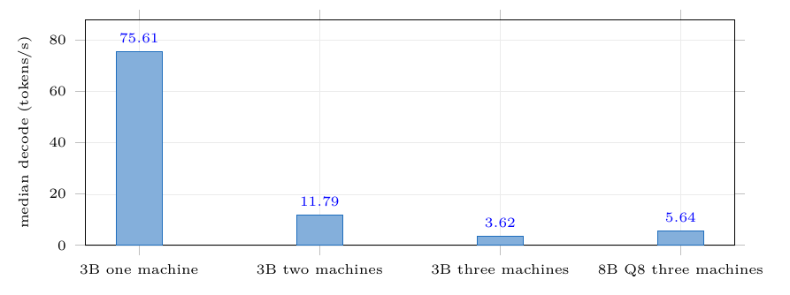

# HyperPod Benchmarks

Measured 30 October 2026. These results describe one consumer-laptop/Wi-Fi
setup; they are not universal performance claims.

## Hardware and network

| Component | Measured configuration |
|---|---|
| Controller | ASUS ROG laptop, Linux, RTX 3050 Laptop GPU, 4,096 MiB VRAM, 15,235 MiB RAM |
| Worker | ASUS TUF laptop, Windows, RTX 4050 Laptop GPU, 6,141 MiB VRAM, 16,003 MiB RAM |
| llama.cpp | Release `b11909` / RPC protocol 8.0.1 on both systems |
| Model | Llama 3.2 3B Instruct, Q4_K_M GGUF |
| Context | 2,048 tokens |
| Wi-Fi | `Krish_5g`, 5,785 MHz, signal -56 dBm during benchmark |
| ROG link report | RX 780.0 Mbit/s; TX 292.5 Mbit/s (driver-reported PHY rates, not application throughput) |
| Split weights | `4763,3204` for TUF RPC then ROG local (measured-free-VRAM policy from the recovered run) |
| Placement | CPU 308 MiB; ROG CUDA0 896 MiB; TUF RPC0 1,022 MiB |

## Performance method

Each mode received five sequential warm-model requests with this prompt:

> Explain distributed computing in exactly 100 words. Use complete sentences
> and do not stop early.

The limit was 160 output tokens. The first request performed full prompt
processing; later requests benefited from llama.cpp prompt caching. Output
length varied because normal model sampling was retained. We report the median
and range rather than presenting a single fastest run.

Modes:

1. **ROG-only native llama.cpp:** direct request to a local llama-server.
2. **Native split llama.cpp:** direct request to llama-server using the TUF RPC
   endpoint and the same tensor weights.
3. **HyperPod split:** request through the Go controller to the same split
   llama-server.

## Performance results

| Mode | Runs | Median end-to-end | Range | Median decode throughput |
|---|---:|---:|---:|---:|
| ROG-only native | 5 | **1.543 s** | 1.505–1.623 s | **75.54 tok/s** |
| Native llama.cpp split | 5 | **11.947 s** | 7.122–15.025 s | **13.19 tok/s** |
| HyperPod split | 5 | **11.804 s** | 10.739–15.930 s | **11.79 tok/s** |

HyperPod's median end-to-end time differed from direct split llama.cpp by only
0.143 seconds in this small sample. The decode medians varied more; no speedup or
statistically significant overhead claim is made.

The meaningful comparison is ROG-only versus Wi-Fi split: distributed decode
was about six times slower. HyperPod is therefore a **capacity and recovery
system**, not a throughput accelerator on this network.

### Per-run end-to-end times (seconds)

| Run | ROG-only | Native split | HyperPod split |
|---:|---:|---:|---:|
| 1 | 1.566 | 7.122 | 10.739 |
| 2 | 1.527 | 15.025 | 10.920 |
| 3 | 1.623 | 8.157 | 15.930 |
| 4 | 1.543 | 13.807 | 11.804 |
| 5 | 1.505 | 11.947 | 14.324 |

### Per-run decode rates (tokens/second)

| Run | ROG-only | Native split | HyperPod split |
|---:|---:|---:|---:|
| 1 | 75.64 | 18.13 | 15.30 |
| 2 | 75.68 | 9.17 | 19.04 |
| 3 | 75.51 | 20.91 | 9.12 |
| 4 | 75.54 | 9.94 | 11.79 |
| 5 | 75.45 | 13.19 | 9.94 |

## Native node-loss benchmark

The same native 3B ROG+TUF split was loaded from cache. A long request began at
23:27:45. The TUF `ggml-rpc-server` was physically stopped with Ctrl+C at
approximately 23:28.

Measured outcome:

```text
curl result: exit 52 / HTTP 000
elapsed until failed client request: 34.06 s
native llama-server: aborted (core dumped)
health endpoint after failure: HTTP 000
process alive after failure: no
automatic restart: none
```

llama.cpp's own error:

```text
Remote RPC server crashed or returned malformed response
```

## HyperPod same-TUF recovery benchmark

The same Windows TUF RPC endpoint was restarted and HyperPod loaded the same 3B
split:

```text
CPU_Mapped 308 MiB + ROG CUDA0 842 MiB + TUF RPC0 1076 MiB
scheduler: measured-free-vram weights=5331,3204; reserve=512 MiB/device
```

A long request began at 23:33:15. The physical TUF RPC server was stopped during
the request. Measured sequence:

```text
23:33:19 llama-server generation 1 aborted
23:33:19 HyperPod classified the EOF as node death and retained the request
23:33:21 unreachable TUF RPC endpoint skipped; generation 2 launched locally
23:33:22 local model ready (CPU 308 MiB + CUDA0 1918 MiB)
```

The **same HTTP request** returned successfully:

```text
ok=true
split=false
response length=1,828 characters
total request time=11.31 seconds
```

The answer began: "Collaboration is a crucial aspect of effective engineering
teams. In a collaborative environment..."

### Failure comparison on the same TUF endpoint

| Behavior | Native llama.cpp | HyperPod |
|---|---|---|
| RPC worker physically stopped | Process aborted | Underlying process aborted |
| Client result | Failed: curl 52 / HTTP 000 | Same request returned HTTP success |
| Service after failure | Down; no health endpoint | Rebuilt on the ROG |
| Automatic restart | None | Yes |
| Automatic request retry | None | Yes |
| Observed time | Failed after 34.06 s | Successful response after 11.31 s total |

The prompts had different requested word counts, so the elapsed numbers should
not be interpreted as a throughput comparison. They measure failure outcome:
native failed and remained down; HyperPod rebuilt and returned the request.

## Heterogeneous three-node recovery evidence

A separate physical heterogeneous run used ROG + Windows TUF + M4 Mac. During
one 420-token request, the Mac RPC process was stopped while its worker heartbeat
remained healthy. HyperPod:

1. observed llama-server abort,
2. recognized the request as interrupted by node death,
3. probed and excluded the unreachable Mac RPC endpoint,
4. rebuilt a still-distributed ROG+TUF topology in 33 seconds,
5. retried the same request, and
6. returned a 1,937-character answer after 75.68 seconds total.

Evidence: [`test/phase6-three-node-recovery.log`](test/phase6-three-node-recovery.log).

This is not a token/KV-cache continuation. The pipeline restarts and the same
request is executed again.

## Capacity result

Llama 3.1 8B Q4 (4.9 GB) was also demonstrated across ROG+TUF:

```text
ROG RAM                       282 MiB
ROG RTX 3050                1,073 MiB
TUF RTX 4050                3,330 MiB
throughput                    6.68 tok/s
```

The 8B result demonstrates pooled capacity. It is not the recovery profile on a
two-machine topology because the ROG cannot hold the entire model in its GPU
memory after losing the TUF.

## Limitations of this benchmark

- Five trials are enough for a reproducible demo comparison, not a research
  performance claim.
- Output lengths varied and later runs used prompt cache.
- Wi-Fi PHY rates are not measured application bandwidth.
- Native and HyperPod physical failure tests used the same TUF endpoint, but the
  prompts requested different output lengths; failure outcomes, not elapsed
  throughput, are compared.
- No energy-per-token result is claimed; telemetry is displayed but not yet
  integrated over a request.

---

## Three-machine pool, 2 Nov 2026

A later run on a different pool: the M4 Mac was down and a second Windows
RTX 4050 laptop joined, so **every device reported free VRAM** and HyperPod's
own `measured-free-vram` scheduler ran instead of falling back to
`llama.cpp-auto`.

Machines: ROG RTX 3050 controller, KAMALESH RTX 4050, LAPTOP-J2ULDUCA RTX 4050.
Wi-Fi `Krish_5g` 5 GHz at −49 to −54 dBm. llama.cpp `0.7.0-dev` (commit
`caa8191`). Same method as above: one fixed prompt, 128 output tokens, five
sequential requests against a warm model.

| Configuration | Median latency | Median decode | Range |
|---|---:|---:|---|
| 3B, one machine | 1.559 s | **75.61 tok/s** | 75.47–75.83 |
| 3B, three machines | 34.300 s | **3.62 tok/s** | 1.63–3.70 |
| 8B Q8_0 (8.54 GB), three machines | 22.656 s | **5.64 tok/s** | 5.10–6.16 |



**A third machine made it slower, by 3.3×.** The two-machine 3B split above ran
at 11.79 tok/s; three machines gives 3.62. Local is now 20.9× faster than the
distributed path rather than 6×. A layer split is a pipeline: devices compute in
sequence with a network transfer between stages, so each device added puts
another hop on every token. Pooling machines aggregates memory, not compute.

**The 8B ran faster than the 3B on the same three machines** (5.64 against
3.62 tok/s). We cannot explain this. Both place weights on the same four
buffers and so cross the same number of hops per token. Reported because it is
measured, with no mechanism claimed.

One three-machine 3B run took 73.8 s — 613 ms per token against roughly 275 for
the other four, at the same token count. Cause not isolated. It is kept in the
range rather than discarded, because a request more than doubling is itself a
statement about stability.

Full log: [`test/phase8-three-machine-benchmark.log`](test/phase8-three-machine-benchmark.log)

### Recovery on this pool

Three machines to two, with HyperPod scheduling both the initial load and the
rebuild:

```text
llama-server (gen 3) exited: signal: aborted (core dumped)
pool: skipping 192.168.1.29:50052
   (worker heartbeat ok, but its rpc-server is unreachable)
launched llama-server (gen 4) over [192.168.1.5:50052];
   scheduler=measured-free-vram weights=5155,3584 reserve=512MiB;
   reclaimed from previous gen: local 950 MiB
     + 192.168.1.29:50052 514 MiB + 192.168.1.5:50052 454 MiB
pipeline ready (gen 4) after 27s
```

The original request returned 5,731 characters after 177.49 s without being
resubmitted. The machine whose accelerator was killed stayed **healthy and
heartbeating 1.4 s later** — a live laptop with a dead accelerator, which is
the condition the exclusion message names.

Full log: [`test/phase9-allnvidia-recovery.log`](test/phase9-allnvidia-recovery.log)
