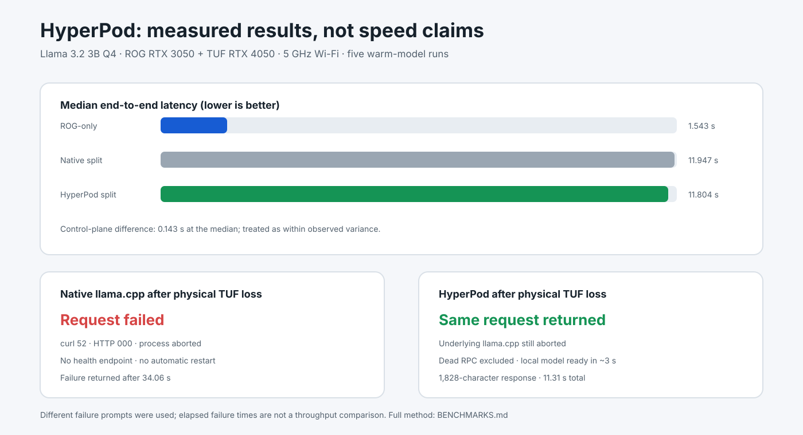
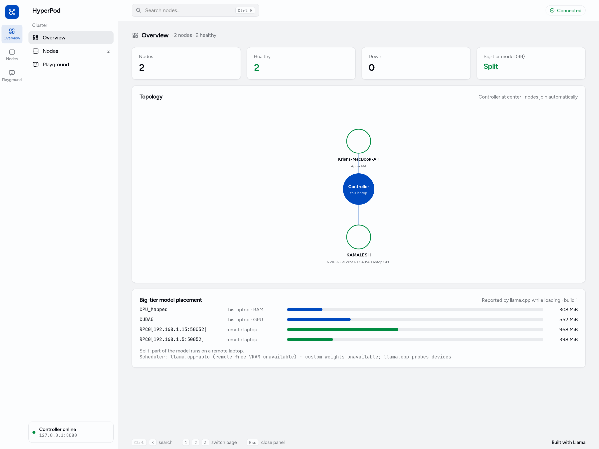
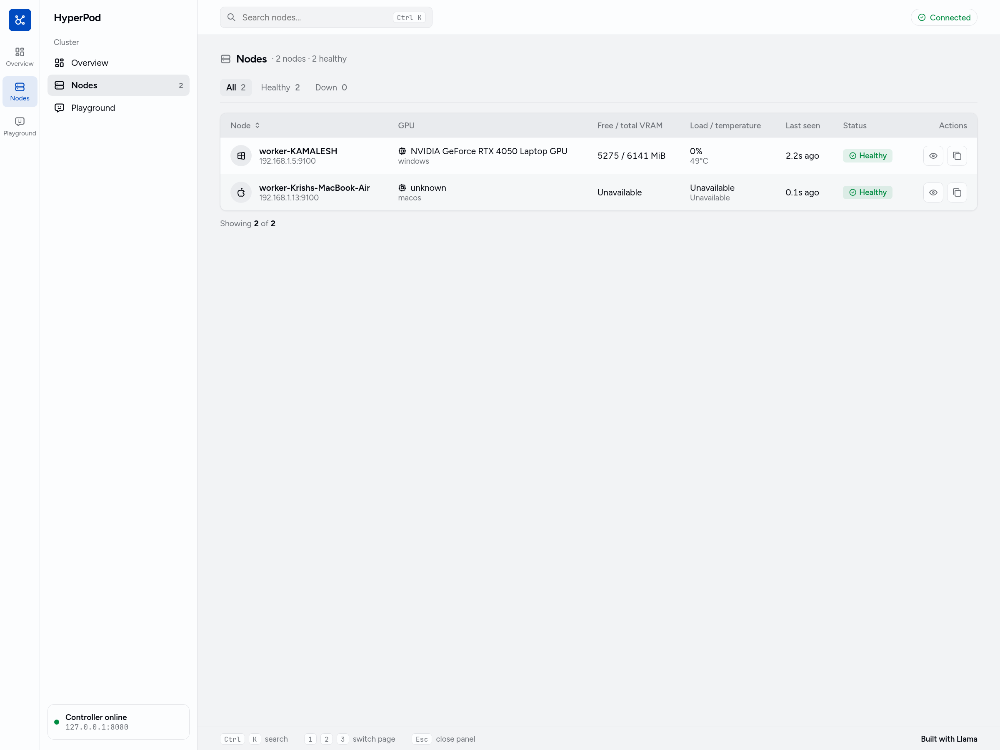
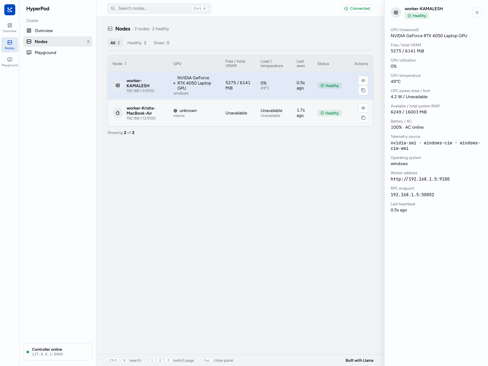
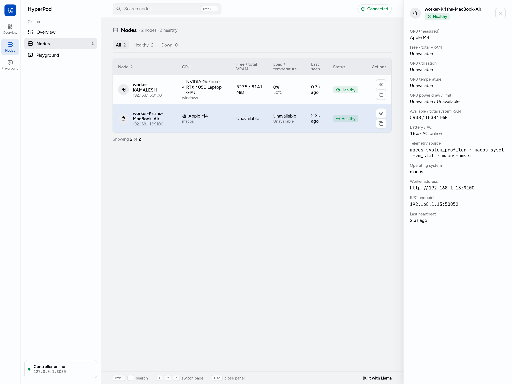
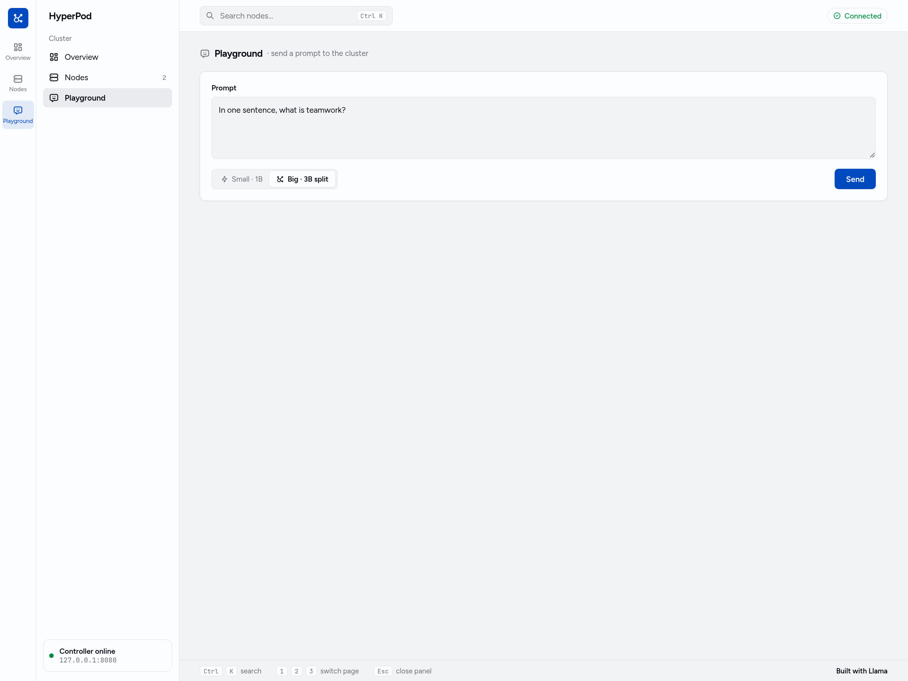
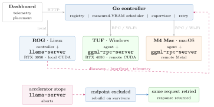

# HyperPod

> **Built with Llama** · Meta open-weight models on hardware you already own.

HyperPod is a local inference controller that discovers consumer laptops on the
same trusted network, measures their available GPU memory, distributes a Meta
Llama model across them through llama.cpp RPC, and restores service when a
remote inference process disappears.

HyperPod is a hackathon prototype for a problem experienced firsthand: a
builder may own several modest laptops but no single large GPU. Those laptops
can add useful memory, but Wi-Fi and user-owned devices are not reliable server
infrastructure. HyperPod makes the placement observable and treats failure as a
normal control-plane event.

## What is proven

| Result | Measured evidence |
|---|---|
| Cross-platform pool | Linux ROG RTX 3050 controller + Windows TUF RTX 4050 + M4 Mac/Metal over Wi-Fi |
| Real 3B split | llama.cpp placed weights on ROG CUDA, TUF RPC and M4 RPC in the three-machine test |
| Measured scheduling | Weights `5331,3204` from free VRAM `5843,3716` minus 512 MiB/device; no GPU-name inference |
| Real 8B capacity run | Llama 3.1 8B Q4: 1,073 MiB on ROG GPU + 3,330 MiB on TUF GPU; 6.68 tok/s |
| Real worker-loss recovery | Killing TUF RPC caused llama-server to abort; HyperPod rebuilt 3B on ROG in about 3 seconds; the next request succeeded |
| Same-request retry | Physically verified for both M4 loss (three→two nodes) and TUF loss (two→local) |
| Live telemetry | GPU/VRAM/load/temperature/power, RAM, battery and AC state from `nvidia-smi` and OS interfaces |

Raw evidence is committed under [`test/*.log`](test/). The latest measured
telemetry and scheduler run is
[`test/phase5-telemetry-scheduler.log`](test/phase5-telemetry-scheduler.log).



## Dashboard

Captured from the live three-machine cluster: a Linux ROG controller, a Windows
TUF worker and an M4 Mac worker.

Overview shows the topology and the placement llama.cpp actually loaded:



Nodes shows measured hardware. The Windows worker reports real VRAM, load and
temperature; the Mac reports its real Apple chip and unified-memory figures:



The detail panel lists every measured field and names its collection source.
Windows via `nvidia-smi` and CIM/WMI:



macOS via `system_profiler`, `sysctl`/`vm_stat` and `pmset`. Apple Silicon
shares one memory pool, so there is no separate free-VRAM value to measure and
those fields stay `Unavailable` instead of reusing system RAM:



The playground reports which devices served each answer:



## What HyperPod does

- Discovers worker agents through UDP broadcast on a local subnet.
- Registers workers and refreshes health/telemetry through HTTP heartbeats.
- Preserves unavailable measurements as JSON `null`; it never invents capacity.
- Calculates deterministic tensor weights from measured free VRAM minus a
  512 MiB runtime reserve per device.
- Falls back explicitly to llama.cpp's own device probing when measurements are
  unavailable.
- Launches and supervises a llama.cpp server over healthy RPC endpoints.
- Parses llama.cpp's own load log to show where model weights actually reside.
- Rebuilds the pipeline after the supervised llama-server exits.
- Offers a local 1B tier and a configurable distributed tier (3B by default;
  8B has also been demonstrated).
- Presents workers, telemetry, scheduling and model placement in a React UI.

## Architecture



Detailed control flow, telemetry sources, recovery sequence and trust boundaries:
[`docs/ARCHITECTURE.md`](docs/ARCHITECTURE.md).

The controller does not implement transformer kernels. llama.cpp performs the
actual layer/device offload. HyperPod adds discovery, measured placement,
observability, process supervision and recovery around it.

Supporting material:

- [Benchmarks and physical failure results](BENCHMARKS.md)
- [Submission narrative](docs/SUBMISSION_DRAFT.md)
- [Demo script](docs/DEMO_SCRIPT.md)
- [Release checklist](docs/RELEASE_CHECKLIST.md)

## Repository layout

```text
controller/   Go control plane, registry, telemetry, scheduler and supervisor
worker/       Rust cross-platform worker and telemetry collectors
frontend/     Vite + React + TypeScript dashboard
launchers/    Windows/Linux demo launchers
PROTOCOL.md   Current controller/worker wire contract
test/         Committed evidence logs (models/builds are ignored)
docs/         Architecture, demo script, submission draft, release checklist, images
```

## Demo setup

The tested setup uses:

- Controller: Linux ROG, RTX 3050 Laptop GPU, 4,096 MiB VRAM
- Worker: Windows TUF, RTX 4050 Laptop GPU, 6,141 MiB VRAM
- llama.cpp release `b11909` / RPC protocol 8.0.1 on both machines
- Trusted 5 GHz Wi-Fi LAN
- Llama 3.2 1B/3B and Llama 3.1 8B Q4 GGUF files stored outside Git

The included launchers contain demo-specific paths and should be edited once for
your machines. See [`launchers/README.md`](launchers/README.md).

### Controller (Linux)

Build:

```bash
cd controller
go test ./...
go vet ./...
go build -o hyperpod-controller .

cd ../worker
cargo test --locked
cargo clippy --locked -- -D warnings
cargo build --release --locked

cd ../frontend
npm install
npm run build
```

Start the controller/dashboard using the documented launcher configuration:

```bash
bash launchers/start-controller.sh
cd frontend
VITE_CONTROLLER=http://CONTROLLER_IP:8080 npm run dev
```

### Worker (Windows)

The tested Windows launcher expects:

- llama.cpp CUDA binaries in `C:\llama-cuda`
- a local 1B GGUF at `C:\llama\models\Llama-3.2-1B-Instruct-Q4_K_M.gguf`
- the Rust worker at
  `D:\meta\hyperpod\worker\target\release\hyperpod-worker.exe`

Edit the configuration block in `launchers/start-worker.bat`, then run it. It
starts both `ggml-rpc-server` (with a local tensor cache) and the Rust worker.

## API summary

- `POST /register` — register a worker and telemetry snapshot
- `POST /heartbeat` — refresh liveness and measured telemetry
- `GET /status` — list workers, health and telemetry
- `GET /pipeline` — report load state, real placement and scheduler decision
- `POST /infer` — run `small` or `big` tier inference
- UDP `50999` — local worker discovery announcements

See [`PROTOCOL.md`](PROTOCOL.md) for schemas.

## Honest limitations

- **Trusted LAN only.** Upstream llama.cpp describes RPC as fragile and insecure.
  HyperPod currently adds no authentication or encryption. Never expose its RPC
  ports to the public Internet.
- **Not a speed-up system.** The measured 3B split was about 6.5 tok/s versus
  roughly 70 tok/s on the ROG alone. Wi-Fi communication dominates. Pooling is
  useful for capacity and recovery, not acceleration on this network.
- **Recovery is restart + retry, not token checkpointing.** The underlying
  llama-server aborts when an RPC peer dies. HyperPod launches a new topology.
- **Two-node 8B is capacity-only.** The 8B Q4 model does not fit wholly in the
  ROG's VRAM, so losing the TUF cannot currently preserve that placement.
- **Same-request recovery restarts inference.** Physical M4 and TUF failures are
  verified, but HyperPod does not preserve already generated tokens or KV cache.
- **Scheduler scope:** weights use measured usable VRAM. Compute throughput and
  network bandwidth are displayed/researched but are not yet scheduler inputs.
- **Discovery is one local broadcast domain.** Routed networks require manual
  endpoints or a future discovery mechanism.
- **macOS/Metal RPC was validated in one heterogeneous three-machine run.**
  HyperPod reports the Apple chip name and unified-memory figures, but Apple
  Silicon has no separate free-VRAM value to measure, so mixed CUDA/Metal
  placement explicitly uses llama.cpp's own device probing.

## Why Meta open weights matter

HyperPod does more than call a model endpoint: it schedules, moves, observes and
recovers Meta model weights on physical devices. The open-weight Llama family
makes it possible to demonstrate three deployment profiles locally:

- Llama 3.2 1B — fast local tier
- Llama 3.2 3B — recoverable distributed profile
- Llama 3.1 8B — pooled-capacity profile

No model weights are committed to this repository.

## Attribution and licensing

HyperPod's own source code is licensed under the Apache License 2.0. See
[`LICENSE`](LICENSE) and [`NOTICE`](NOTICE).

**Built with Llama.** The models are not part of this repository and carry
Meta's own terms. Llama 3.1 and Llama 3.2 are licensed under their respective
Community License Agreements; llama.cpp is MIT. Source links and acceptable-use
policies are in [`THIRD_PARTY_NOTICES.md`](THIRD_PARTY_NOTICES.md).
