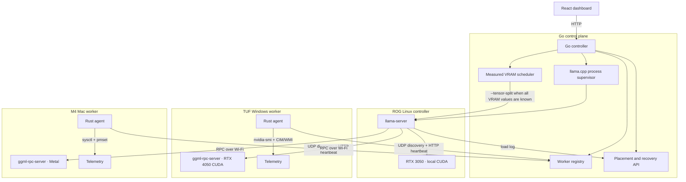
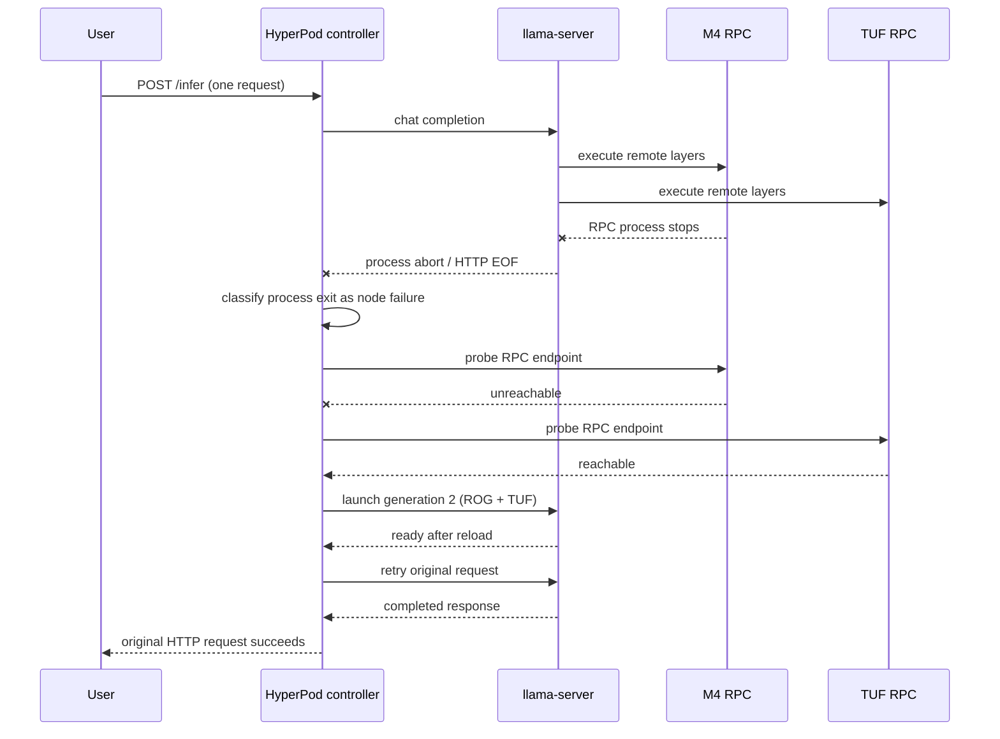

# HyperPod Architecture

HyperPod is a control plane around llama.cpp RPC for a trusted local network. It
does not implement transformer kernels or replace llama.cpp's device backend.

## Components



## Control flow

1. A worker samples telemetry every five seconds.
2. It registers with the controller and sends a heartbeat every three seconds.
3. UDP discovery lets workers appear without a preconfigured worker list.
4. The controller verifies each RPC endpoint before including it.
5. If every selected NVIDIA device has measured free VRAM, the scheduler uses:

   ```text
   weight = measured free VRAM − 512 MiB reserve
   ```

6. RPC endpoints are sorted, making the generated weight list deterministic.
7. llama.cpp receives RPC endpoints first and the local GPU last in
   `--tensor-split`.
8. If a required free-memory value is unavailable, HyperPod omits custom
   weights and records `llama.cpp-auto`; it does not invent capacity.
9. llama.cpp loads model layers and reports actual per-device buffer sizes.
10. HyperPod parses those lines and exposes requested weights and actual
    placement separately through `GET /pipeline`.

## Telemetry contract

Schema version 1 keeps unavailable values explicit:

```text
Telemetry
├── GPU: name, total/free VRAM, utilization, temperature, draw, limit
├── Memory: total/available system RAM
└── Power: battery percentage, AC state
```

Sources:

| Platform | GPU | Memory | Power |
|---|---|---|---|
| Linux/NVIDIA | `nvidia-smi` | `/proc/meminfo` | `/sys/class/power_supply` |
| Windows/NVIDIA | `nvidia-smi` | CIM | CIM/WMI |
| macOS | unavailable | `sysctl` total | `pmset` |

Metal free memory is not reported by HyperPod. Mixed CUDA/Metal placement uses
llama.cpp's own device probing and is labelled as such.

## Verified recovery sequence



Measured physical run:

```text
Initial:   ROG CUDA 552 MiB + M4 RPC 968 MiB + TUF RPC 398 MiB
Failure:   M4 RPC stopped while its Rust heartbeat remained healthy
Recovery:  ROG CUDA 896 MiB + TUF RPC 1,022 MiB
Reload:    33 seconds
Request:   same HTTP request returned 1,937 characters in 75.68 seconds total
```

This is process restart and request retry. HyperPod does not preserve the failed
KV cache or already generated tokens.

## Trust boundaries

HyperPod is currently limited to a trusted local network:

- llama.cpp RPC has no authentication or encryption.
- Controller APIs have no authentication.
- UDP discovery accepts local broadcasts.
- The controller is a single point of failure.

Do not expose ports 50052, 8080, 9100 or 50999 to the public Internet.

## Model profiles

| Profile | Purpose | Proven behavior |
|---|---|---|
| Llama 3.2 1B | Fast local fallback | Local inference |
| Llama 3.2 3B | Recovery demonstration | ROG+TUF+M4 to ROG+TUF; same request retry |
| Llama 3.1 8B | Capacity demonstration | ROG 1,073 MiB + TUF 3,330 MiB; 6.68 tok/s |

The 8B two-node profile is not the failure-recovery profile because the model
does not fit wholly in the ROG's GPU memory after losing the TUF.
